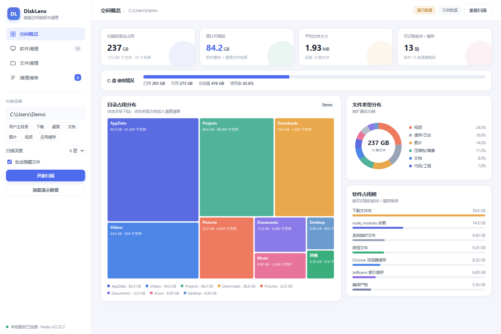
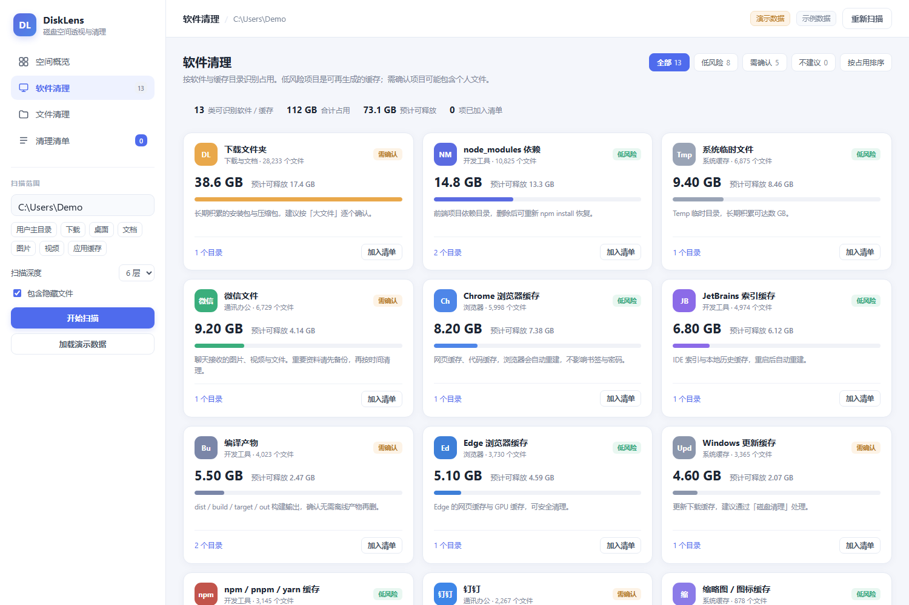

# clean-manager

> 本地磁盘空间可视化与安全清理工具 · 零依赖 · 仅监听 `127.0.0.1` · 绝不永久删除文件

界面产品名为 **DiskLens**。它把磁盘占用画成可下钻的树状图，并把清理拆成「软件清理」和「文件清理」两条路径：先看清楚空间被谁占了，再逐项确认后把文件移入系统回收站。



## 特性

- **直观可视化**：Squarify Treemap 目录占用图（点击下钻、面包屑返回）、文件类型环形图、软件占用条形榜、磁盘容量条。
- **软件清理**：内置 30+ 条识别规则，覆盖微信 / QQ / 钉钉 / 企业微信、Chrome / Edge / Firefox 缓存、node_modules、npm / pnpm / pip / Gradle / Maven / Cargo / Go 缓存、JetBrains / VS Code / Xcode 缓存、系统临时文件、Windows 更新缓存、Adobe 媒体缓存、Steam 下载缓存、下载文件夹等；按「低风险 / 需确认 / 不建议」分级并给出预计可释放空间。
- **文件清理**：目录占用、大文件（> 100 MB）、重复文件（文件大小 + 内容指纹）、陈旧文件（一年以上未修改）、文件类型分布五个视角。
- **安全清理**：所有操作只把项目移入**系统回收站**，可随时还原；不做永久删除，不做程序卸载。
- **开箱即用**：Node.js 18+ 即可运行，零第三方依赖、零构建步骤；内置演示数据，不扫描真实磁盘也能预览全部功能。
- **跨平台**：Windows / macOS / Linux，回收站调用按平台自动适配。

## 快速开始

### 环境要求

- Node.js **18 或更高版本**（仅使用 Node 内置模块，无需 `npm install`）
- 现代浏览器（Chrome / Edge / Firefox / Safari）

### 启动

| 平台 | 方式 |
| --- | --- |
| Windows | 双击 `启动.bat`，会自动打开浏览器 |
| macOS / Linux | 执行 `./start.sh` |
| 任意平台（命令行） | `node server.js`（加 `--open` 自动打开浏览器） |

服务默认监听 `http://127.0.0.1:8787`，端口被占用时自动顺延；可用 `PORT=9000 node server.js` 指定端口。按 `Ctrl+C` 停止服务。

### 使用流程

1. 打开页面后默认展示**演示数据**（右上角有标识），可以直接体验所有视图，演示模式不会执行任何真实清理。
2. 在左侧选择快捷目录或输入绝对路径，设置扫描深度，点击「开始扫描」；扫描期间可查看进度并随时取消。
3. 在「软件清理」或「文件清理」中勾选目标项目，它们会进入「清理清单」。
4. 在清理清单中逐项核对路径，勾选确认后执行；结果会显示成功与失败明细，文件可在系统回收站中还原。
5. 清理完成后点击「重新扫描」刷新占用数据。



## 安全设计

这是本项目最重要的部分。清理功能遵循以下约束，前后端双重校验：

| 约束 | 说明 |
| --- | --- |
| 只进回收站 | Windows 通过 `Microsoft.VisualBasic.FileIO` 的 `SendToRecycleBin`，macOS 通过 Finder / `~/.Trash`，Linux 通过 `gio trash` / Freedesktop 废纸篓；**不会调用永久删除** |
| 范围限制 | 目标路径必须位于本次扫描根目录之内，且不能是根目录本身或磁盘根 |
| 链接逃逸防护 | 用 `realpath` 复核真实路径，符号链接指向扫描范围之外会被拦截 |
| 系统路径保护 | `Windows/System32`、`Windows/WinSxS`、系统库目录、回收站目录等被列入禁止清单 |
| 小批量 | 单批最多 10 项 |
| 二次确认 | 执行前弹窗列出全部路径，必须勾选确认才可继续 |
| 演示数据只读 | 演示模式下禁止执行清理 |
| 服务本地化 | HTTP 服务只绑定 `127.0.0.1`，不对外网暴露 |

> 提示：「软件清理」识别的是软件产生的**缓存与数据目录**，不是卸载程序本身。卸载请通过系统设置或软件自带的卸载程序完成。

## 技术栈

- 后端：Node.js 原生 ES Modules（`http` / `fs` / `crypto` / `child_process`），异步递归扫描并通过 `setImmediate` 让出事件循环，保证扫描时进度接口仍可响应。
- 前端：原生 ES6 JavaScript + HTML + CSS，无框架、无构建。Treemap 使用 Squarify 算法，图表为手写 SVG。
- 语言统一为 JavaScript，前后端同语言、零依赖。

## 目录结构

```
clean-manager/
├── server.js          # 静态资源与 REST API，仅监听 127.0.0.1
├── scanner.js         # 扫描引擎：进度/取消/限深/类型/大文件/陈旧/重复/软件占用
├── rules.js           # 文件类型分类、软件与缓存识别规则、系统保护路径
├── trash.js           # 回收站删除与路径白名单校验
├── demo.js            # 演示数据生成
├── public/
│   ├── index.html     # 单页界面结构
│   ├── styles.css     # 浅色主题样式
│   └── app.js         # 可视化渲染与交互
├── docs/              # 界面截图
├── 启动.bat           # Windows 启动入口
├── start.sh           # macOS / Linux 启动入口
├── package.json
└── .gitattributes     # 保证 .sh / .bat 换行符正确
```

## REST API

| 接口 | 说明 |
| --- | --- |
| `GET /api/config` | 平台信息与常用扫描目录 |
| `GET /api/drives` | 磁盘分区容量 |
| `POST /api/scan` | 启动扫描，返回任务 ID |
| `GET /api/scan/status?id=` | 扫描进度、当前路径、状态 |
| `GET /api/scan/result?id=` | 完整扫描结果 |
| `POST /api/scan/cancel` | 取消扫描 |
| `GET /api/demo` | 演示数据 |
| `POST /api/trash` | 校验并把选中项目移入回收站 |
| `POST /api/reveal` | 在系统文件管理器中定位文件 |

## 常见问题

- **扫描很慢？** 大目录建议降低扫描深度；引擎默认最多统计 15 万个文件，且可随时取消。跳过系统保护目录与符号链接。
- **软件清理列表是空的？** 识别依赖已知缓存路径规则，请扫描包含应用数据的目录（例如用户主目录）。
- **端口被占用？** 服务会自动尝试下一个端口，启动日志会打印实际地址。
- **误删了怎么办？** 打开系统回收站还原即可，本工具不提供永久删除。

## 贡献

欢迎提交 Issue 与 Pull Request。新增软件识别规则只需在 `rules.js` 的 `SOFTWARE_RULES` 中增加一条，包含 `id`、`name`、`category`、`risk`、`advice` 与 `match` 路径片段即可。

## 许可证

本项目采用 [MIT License](LICENSE)：可自由使用、修改、商用与再分发，只需保留版权声明。
